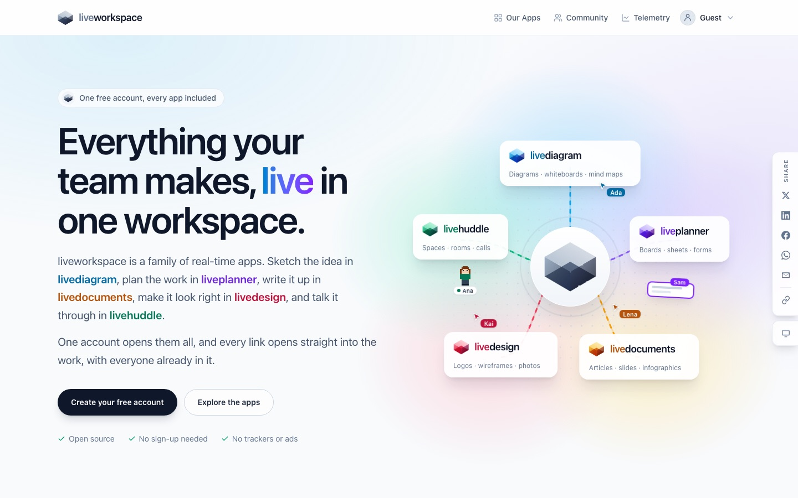
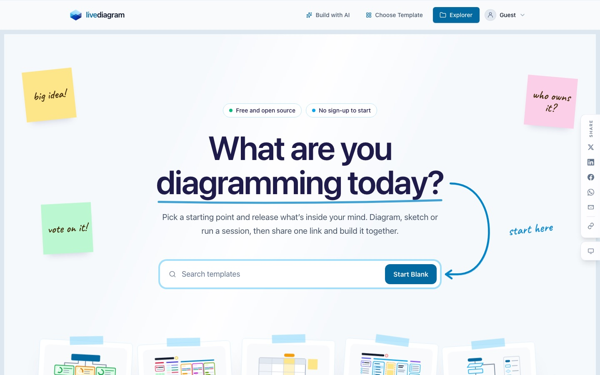
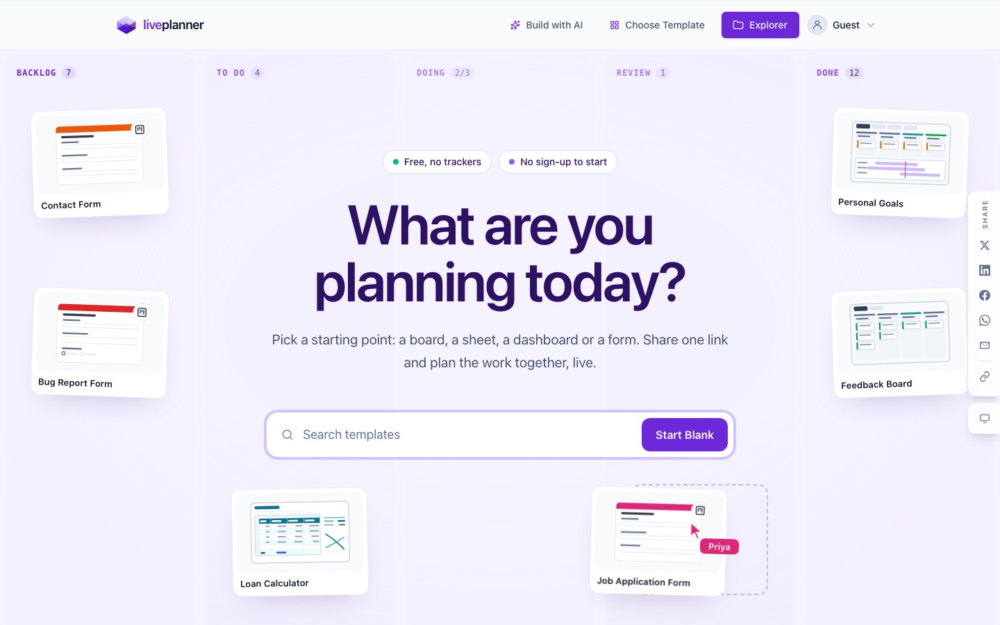
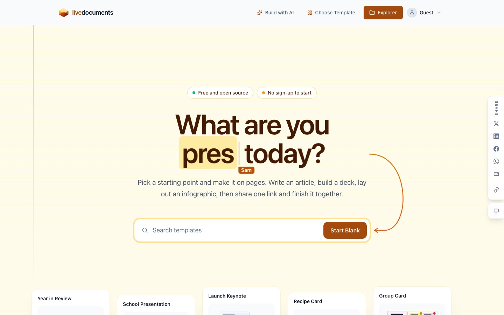
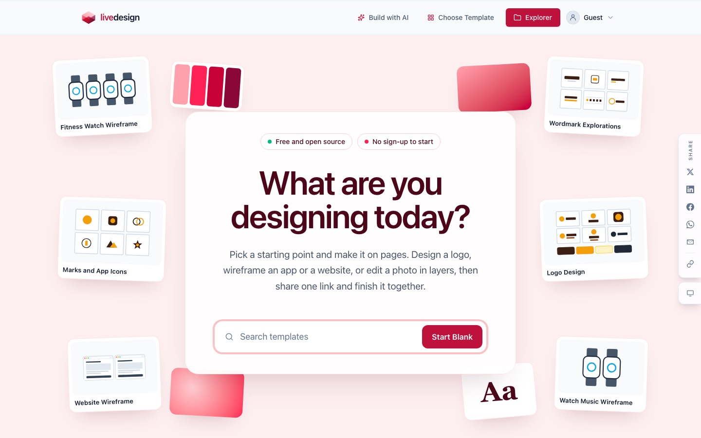
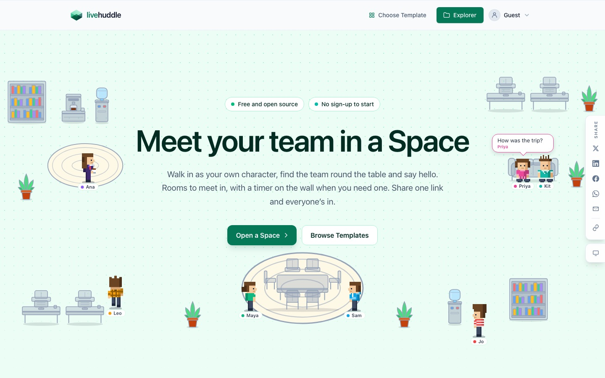
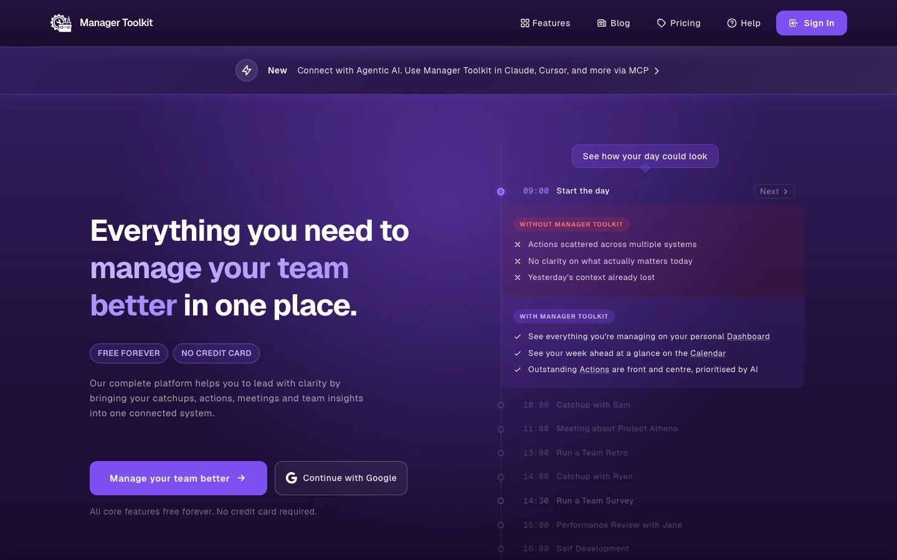
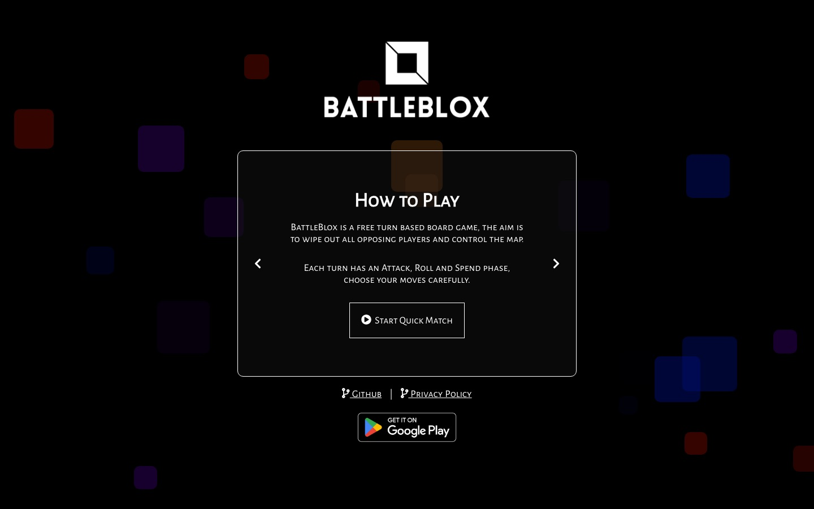
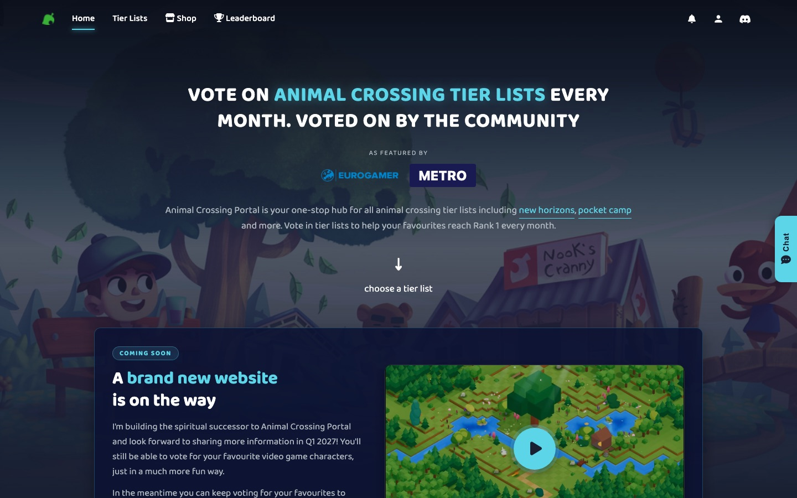
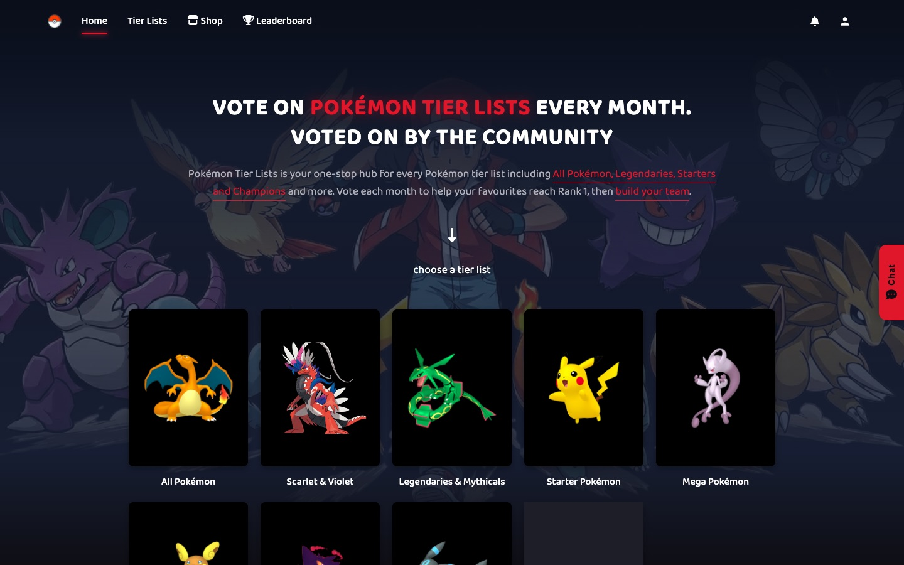

### Thomas William McClean 👋
> I am a Technology Manager, Team Lead and Senior Full-Stack Software Engineer working for `Just Eat Takeaway` in the United Kingdom.

- 😄 **Pronouns**: He / Him
- 💻 **Preferred Tech**: Web Platforms such as NuxtJS, NextJS, VueJS, NodeJS, C# .NETCore, Azure, AWS

## My Apps

### liveworkspace
A family of free, real-time apps, each built for one kind of work. One account opens them all, every link opens straight into the work with everyone already in it, and there are no trackers or ads. The apps below all live in one open source monorepo.

🌐 [liveworkspace.app](https://www.liveworkspace.app) · 📦 [Repository](https://github.com/livediagram-app/livediagram.app)

### livediagram
A free, real-time canvas for diagrams, whiteboards, mind maps and workshops, built for teams who think visually. Start from a template or a blank canvas, sketch together live, and share it with one link. It also works with AI assistants through its MCP server, so Claude can draw and edit diagrams for you.

🌐 [livediagram.app](https://www.livediagram.app) · 📦 [Repository](https://github.com/livediagram-app/livediagram.app/tree/main/livediagram)

### liveplanner
Plan the work together, live. Boards of cards, spreadsheets, dashboards and forms sit side by side in one plan, shared with one link. No sign-up needed to start.

🌐 [liveplanner.app](https://www.liveplanner.app) · 📦 [Repository](https://github.com/livediagram-app/livediagram.app/tree/main/liveplanner)

### livedocuments
Write, present and design on pages together. A real-time editor for articles, slide decks and infographics, built for teams who write and present together.

🌐 [livedocuments.app](https://www.livedocuments.app) · 📦 [Repository](https://github.com/livediagram-app/livediagram.app/tree/main/livedocuments)

### livedesign
Design logos, wireframes and photos together, live. A real-time editor for teams who design together, from a first logo idea to a finished wireframe.

🌐 [livedesign.app](https://www.livedesign.app) · 📦 [Repository](https://github.com/livediagram-app/livediagram.app/tree/main/livedesign)

### livehuddle
Meet your team in a Space. Walk in as your own character, gather round the table and say hello, with rooms to meet in and a timer on the wall when you need one.

🌐 [livehuddle.app](https://www.livehuddle.app) · 📦 [Repository](https://github.com/livediagram-app/livediagram.app/tree/main/livehuddle)

### Manager Toolkit
Everything you need to manage your team better, in one place. Track catchups, meetings, actions, targets, retrospectives and surveys, with AI-powered insights, and connect it to Claude, Cursor and more over MCP. Free forever for core features.

🌐 [manager-toolkit.com](https://www.manager-toolkit.com)

### BattleBlox
A challenging, free turn based strategy board game. Each turn has an Attack, Roll and Spend phase, and the aim is to wipe out every opposing player and control the map. Also on Google Play.

🌐 [battleblox.tommcclean.me](https://www.battleblox.tommcclean.me) · 📦 [Repository](https://github.com/BattleBlox)

### Animal Crossing Portal
The authority on villager popularity. Vote every month in community tier lists for New Horizons, Pocket Camp, villagers and more, as featured by Eurogamer and Metro.

🌐 [animalcrossingportal.com](https://www.animalcrossingportal.com)

### Pokémon Tier Lists
A Pokémon fansite where the community votes every month to rank All Pokémon, Legendaries, Starters and more, then builds their dream team.

🌐 [pokemontierlists.com](https://www.pokemontierlists.com)
